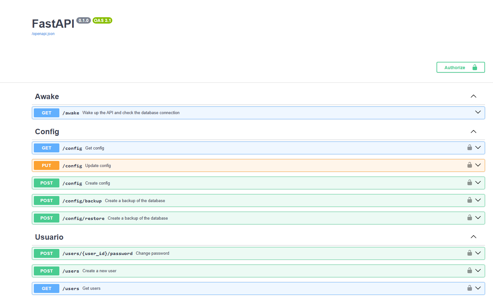

# 📦 API de Inventario | Inventory API

🚀 _API REST para la gestión de inventario, compras y ventas de una tienda pequeña._
🚀 _REST API for managing inventory, purchases and sales of a small store._

📌 **Enlace a la demo | Live demo link:** [🔗 Ver en Vivo | View Live](https://inventory-ni.netlify.app)

---

## 🎯 Sobre este Proyecto | About this Project

### Español:

Esta es una API RESTful construida con **FastAPI** y **MongoDB** que sirve como backend de un sistema de inventario para tiendas. Permite administrar productos, proveedores, compras, ventas y usuarios con distintos roles, actualizando automáticamente el stock y el historial de precios de cada producto con cada movimiento.

Además genera **reportes en Excel**, **recibos de venta en PDF**, estadísticas para el dashboard y permite hacer **respaldos y restauraciones** completas de la base de datos.

La API está diseñada para integrarse con un frontend construido en **Vue 3 + Element Plus**. ([🔗 Ver repositorio](https://github.com/ErickRuiz97/inventory-frontend))

Proyecto desarrollado en colaboración con [ErickRuiz97](https://github.com/ErickRuiz97).

_¡Este proyecto no es solo una carta de presentación, sino una muestra real de mis habilidades como desarrollador full-stack!_

### English:

This is a RESTful API built with **FastAPI** and **MongoDB** that powers an inventory system for stores. It manages products, suppliers, purchases, sales and role-based users, automatically updating each product's stock and price history on every transaction.

It also generates **Excel reports**, **PDF sale receipts**, dashboard statistics, and supports full database **backup and restore**.

The API is designed to integrate with a frontend built with **Vue 3 + Element Plus**. ([🔗 View repository](https://github.com/ErickRuiz97/inventory-frontend))

Project developed in collaboration with [ErickRuiz97](https://github.com/ErickRuiz97).

_This project is not just a presentation letter, but a real showcase of my skills as a full-stack developer!_

---

## 🎥 Vista Previa | Preview

📸 

---

## ✨ Características Principales | Key Features

### Español:
✅ **Autenticación con `JWT`** y contraseñas cifradas con `bcrypt` (`passlib`).
✅ **Control de acceso por roles**: `ADMIN`, `MANAGER` y `SALES`.
✅ **Productos**: CRUD, categorías, garantía (horas, días, semanas, meses, años) y código autogenerado con prefijo configurable.
✅ **Compras a proveedores**: aumentan el stock, actualizan precios de compra/venta y calculan la tendencia del precio (sube, baja, igual).
✅ **Ventas**: validan stock disponible, descuentan unidades y generan **recibo en PDF** (`fpdf2`) con logo y datos de la empresa.
✅ **Historial de precios** por producto para graficar su evolución.
✅ **Anulación de compras y ventas** con reversión del stock.
✅ **Reportes en Excel** (`pandas` + `openpyxl`) de productos, proveedores, usuarios, compras y ventas (con y sin detalle).
✅ **Dashboard**: top 10 productos más vendidos y top 3 proveedores con mayor gasto, usando agregaciones de `MongoDB`.
✅ **Configuración de la empresa**: nombre, eslogan, logo, moneda (`NIO`, `USD`, `EUR`) y categorías.
✅ **Respaldo y restauración** de toda la base de datos en un archivo `.zip`.
✅ Listados **paginados y filtrables** en todos los módulos.
✅ Soporte para **Docker**.

### English:
✅ **`JWT` authentication** with `bcrypt`-hashed passwords (`passlib`).
✅ **Role-based access control**: `ADMIN`, `MANAGER` and `SALES`.
✅ **Products**: CRUD, categories, warranty (hours, days, weeks, months, years) and auto-generated codes with a configurable prefix.
✅ **Supplier purchases**: increase stock, update purchase/sale prices and compute the price trend (upward, falling, equal).
✅ **Sales**: validate available stock, deduct units and generate a **PDF receipt** (`fpdf2`) with the company's logo and details.
✅ **Price history** per product to chart its evolution.
✅ **Purchase and sale cancellation** with stock rollback.
✅ **Excel reports** (`pandas` + `openpyxl`) for products, suppliers, users, purchases and sales (with or without detail).
✅ **Dashboard**: top 10 best-selling products and top 3 suppliers by spend, using `MongoDB` aggregations.
✅ **Company settings**: name, slogan, logo, currency (`NIO`, `USD`, `EUR`) and categories.
✅ Full database **backup and restore** as a `.zip` file.
✅ **Paginated and filterable** listings in every module.
✅ **Docker** support.

---

## 🗺️ Endpoints

| Módulo / Module | Endpoints |
| --- | --- |
| Auth | `POST /login` |
| Usuarios / Users | `GET, POST /users` · `GET, PUT, DELETE /users/{id}` · `PUT /users/{id}/active` · `POST /users/{id}/password` · `GET /users/report` |
| Productos / Products | `GET, POST /products` · `GET, PUT /products/{id}` · `GET /products/report` |
| Proveedores / Suppliers | `GET, POST /suppliers` · `GET, PUT /suppliers/{id}` · `GET /suppliers/report` |
| Compras / Purchases | `GET, POST /purchases` · `GET, DELETE /purchases/{id}` · `GET /purchases/report` · `GET /purchases/report-detail` |
| Ventas / Sales | `GET, POST /sales` · `GET, DELETE /sales/{id}` · `GET /sales/{id}/receipt` · `GET /sales/report` · `GET /sales/report-detail` |
| Dashboard | `GET /dashboard` |
| Configuración / Settings | `GET, POST, PUT /config` · `POST /config/backup` · `POST /config/restore` |

📖 Documentación interactiva en `/docs` (Swagger) | Interactive docs at `/docs` (Swagger).

---

## 🏗️ Arquitectura | Architecture

```
inventory-api/
├── main.py            # App FastAPI + CORS
├── routes.py          # Registro de routers
├── controllers/       # Endpoints (capa HTTP)
├── services/          # Lógica de negocio, reportes, recibos, backups
├── repositories/      # Acceso a datos (MongoDB)
├── models/            # Entidades Pydantic
├── schemas/           # Esquemas de entrada y filtros de consulta
└── core/              # Auth JWT, conexión a Mongo, variables de entorno, contadores
```

**ES:** Arquitectura en capas `controller → service → repository`. **EN:** Layered `controller → service → repository` architecture.

---

## 🛠 Tecnologías Utilizadas | Technologies Used

- Python 3.11
- FastAPI + Uvicorn
- MongoDB (PyMongo)
- Pydantic v2
- PyJWT + Passlib (bcrypt)
- Pandas + OpenPyXL (reportes Excel | Excel reports)
- fpdf2 (recibos PDF | PDF receipts)
- Pipenv / Docker

### **Despliegue | Deployment:**
- **Backend:** Render
- **Base de datos | Database:** MongoDB Atlas

---

## 🚀 Ejecución local | Running locally

### Requisitos | Requirements
- Python **3.11**
- MongoDB (local o Atlas | local or Atlas)
- Pipenv (`pip install pipenv`)

### Variables de entorno | Environment variables

Crear el archivo `.config/.env` | Create the `.config/.env` file:

```env
MONGO_URI=mongodb://localhost:27017
DB_NAME=inventory
SECRET_KEY=una_clave_secreta_segura
ACCESS_TOKEN_EXPIRE_MINUTES=480
PRO_URI=https://inventory-ni.netlify.app
```

| Variable | Descripción / Description |
| --- | --- |
| `MONGO_URI` | Cadena de conexión a MongoDB / MongoDB connection string |
| `DB_NAME` | Nombre de la base de datos / Database name |
| `SECRET_KEY` | Clave para firmar los JWT / Key used to sign JWTs |
| `ACCESS_TOKEN_EXPIRE_MINUTES` | Duración del token / Token lifetime |
| `PRO_URI` | URL del frontend permitida por CORS / Frontend URL allowed by CORS |

### Con Pipenv | With Pipenv

```bash
pipenv install
pipenv run uvicorn main:app --reload
```

### Con Docker | With Docker

```bash
docker compose up --build
```

Abrir | Open: [http://localhost:8000/docs](http://localhost:8000/docs)

> **ES:** La creación de usuarios requiere un token `ADMIN`, por lo que el primer administrador debe insertarse directamente en la colección `users` de MongoDB (con la contraseña cifrada en bcrypt).
> **EN:** Creating users requires an `ADMIN` token, so the first administrator must be inserted directly into the MongoDB `users` collection (with a bcrypt-hashed password).

---

## 👥 Colaboradores | Contributors

- [Joaquín Núñez Vega](https://github.com/joaquinn6)
- [ErickRuiz97](https://github.com/ErickRuiz97)

---

## 📬 Contacto | Contact

- **📧 Email:** joaquin.software.e@gmail.com
- **💼 LinkedIn:** [Mi LinkedIn](https://www.linkedin.com/in/joaquin-n6/)
- **🐙 GitHub:** [Mi GitHub](https://github.com/joaquinn6)

---

## 📜 Licencia | License
### Español:
📄 Este proyecto está bajo la licencia **MIT**. Siéntete libre de usarlo, modificarlo y compartirlo.

### English:
This project is licensed under the **MIT** license. Feel free to use, modify, and share.
